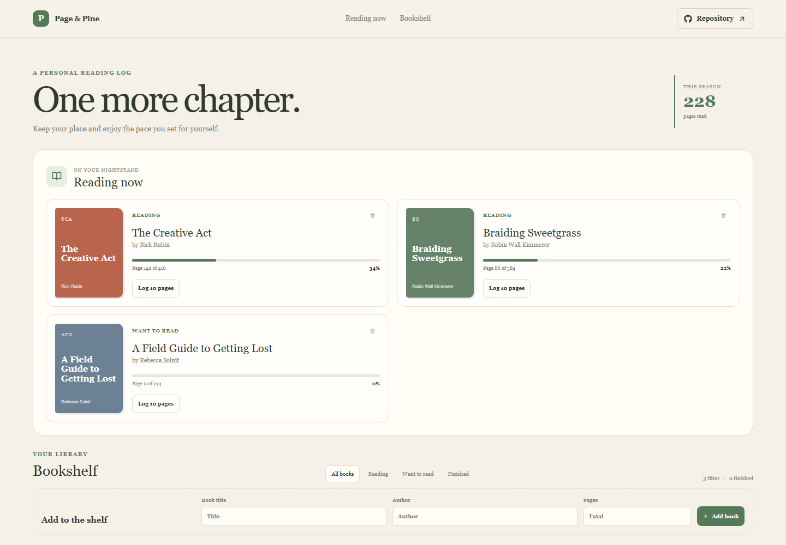

# Page & Pine

Page & Pine is a reading log for remembering what is in progress, what is next, and how far each book has moved.

Live site: https://a2rp.github.io/reading-progress-log/

## How to use it

Add a book title, author, and total page count. Log ten pages from a book card, switch among shelf filters, and confirm before removing a title.

## Features

- Reading cards with page totals and percent complete
- Shelf filters for all books, reading, want to read, and finished
- Log ten pages at a time with progress capped at the final page
- Add a book with author and page count
- Confirmation before removing a book

## Data and limits

Book details and current page counts are saved in localStorage in this browser.

The page counter is manual and the app does not connect to ebook readers or sync your library.

## Run locally

Install Node.js, then run these commands from the project folder:

    npm install
    npm run dev

## Checks and deployment

    npm run lint
    npm run build
    npm run deploy

The deploy command builds the site and publishes the contents of dist to the gh-pages branch. The project is configured for GitHub Pages at https://a2rp.github.io/reading-progress-log/.

## Future improvements

These are ideas only and are not implemented yet:

- Allow exact page entry and reading-session notes (idea, not implemented)
- Add reading goals and streaks (idea, not implemented)
- Import and export a bookshelf (idea, not implemented)

## Links

- Portfolio: [https://www.ashishranjan.net](https://www.ashishranjan.net)
- GitHub: [https://github.com/a2rp](https://github.com/a2rp)
- CodePen: [https://codepen.io/ash1198](https://codepen.io/ash1198)
- LinkedIn: [https://www.linkedin.com/in/aashishranjan](https://www.linkedin.com/in/aashishranjan)
- Facebook: [https://www.facebook.com/theash.ashish/](https://www.facebook.com/theash.ashish/)
- YouTube: [https://www.youtube.com/@ashishranjan-ashz?sub_confirmation=1](https://www.youtube.com/@ashishranjan-ashz?sub_confirmation=1)
- Email: [mailto:ash.ranjan09@gmail.com](mailto:ash.ranjan09@gmail.com)

## Support

- Support: [https://a2rp-donation-page.netlify.app/](https://a2rp-donation-page.netlify.app/)
- Buy Me a Coffee: [https://buymeacoffee.com/ashishranjan](https://buymeacoffee.com/ashishranjan)
- Patreon: [https://www.patreon.com/ashishranjan](https://www.patreon.com/ashishranjan)